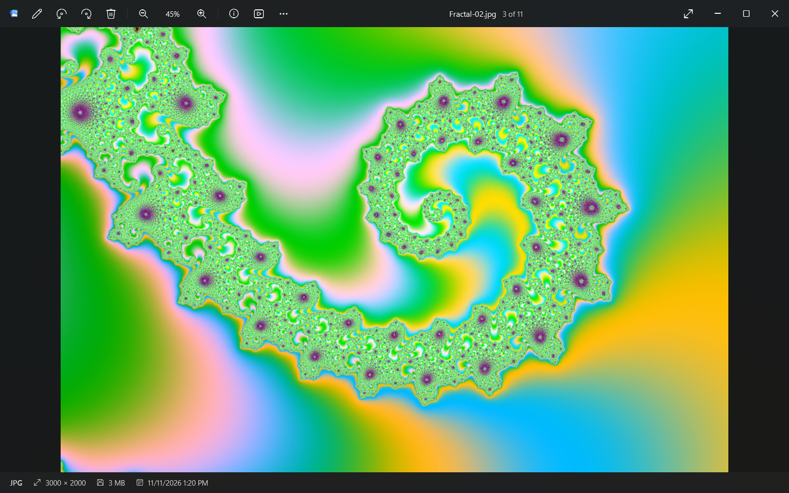
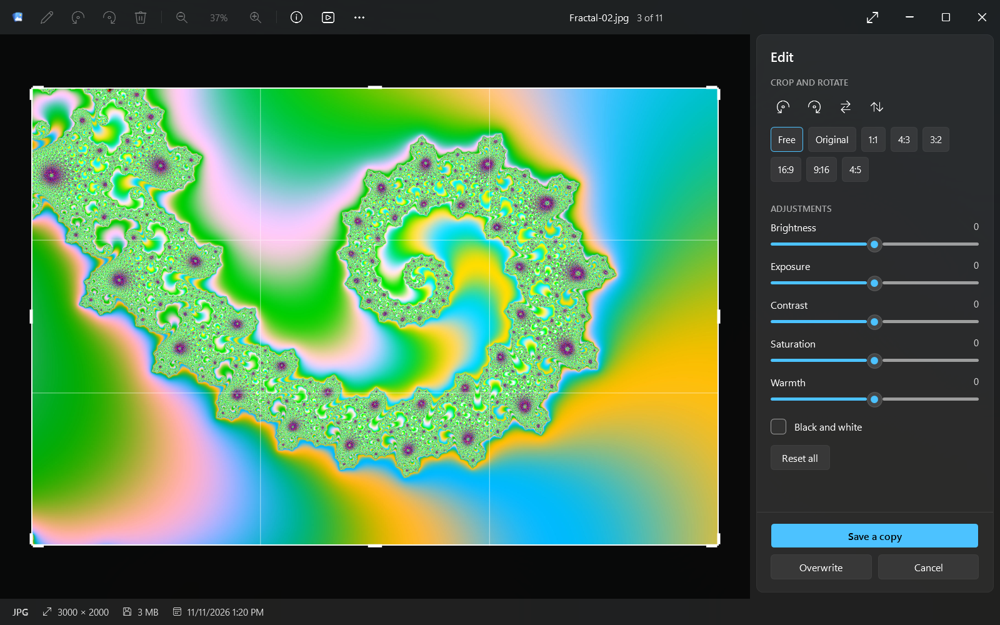
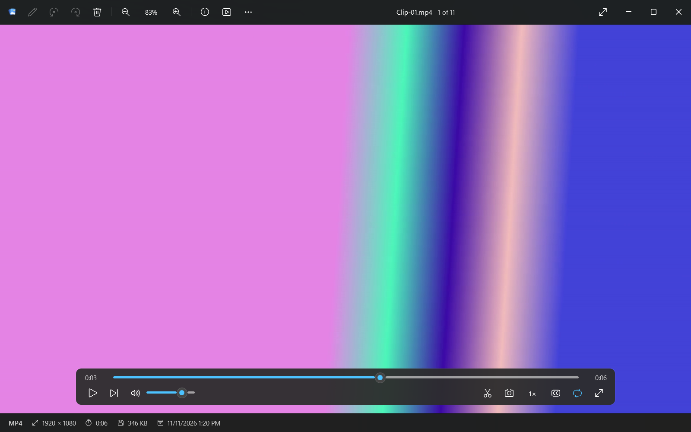

<div align="center">


# Riffle

**Flick through your photos and videos as fast as you can press a key.**

A native Windows 11 photo and video viewer that opens instantly, never makes you wait for the next
picture and plays practically every video format, with no codec packs and no VLC install.

[](https://github.com/IncludePetrol/riffle/actions/workflows/build.yml)
[](https://github.com/IncludePetrol/riffle/releases)


[](LICENSE)

[**Download**](https://github.com/IncludePetrol/riffle/releases) · [Features](#-features) · [Shortcuts](#%EF%B8%8F-keyboard-shortcuts) · [Build](#-build-from-source) · [Italiano](#-in-italiano)

<br>



</div>

<br>

## ⚡ Why Riffle

The Windows Photos app takes a while to open, stutters when you hold the arrow key through a
folder, and needs extra codecs (or VLC) for many video formats. Riffle is built the other way
around: **speed first**, everything else second.

<table>
<tr>
<td width="33%" valign="top">

### 🏎️ Zero-wait scrolling
The next photos are decoded in advance on every CPU core. When you press `→`, the image is
already in memory.

</td>
<td width="33%" valign="top">

### 🎬 Every video, built in
H.264, HEVC/H.265 (4K too), AV1, VP9, MPEG-2/4, WMV in MKV, MP4, MOV, WebM, AVI, TS… Powered by libVLC, bundled.

</td>
<td width="33%" valign="top">

### ✂️ Quick edits
Crop, rotate, flip, brightness, exposure, contrast, saturation, warmth, black & white. Rotation is lossless on JPEG.

</td>
</tr>
</table>

### Measured, not promised

Tested holding the arrow key at the fastest Windows key-repeat rate (30 photos per second),
through a folder of 24-megapixel, ~14 MB JPEGs that had never been opened before:

| | Photos shown fully decoded | Skipped |
| --- | :---: | :---: |
| **Riffle** | **100 / 100** | 0 |
| Riffle's own previous build (with a thumbnail filmstrip) | 27 / 100 | 63 |

Each of those photos reached the screen in **under 0.1 ms** after the key press. It takes about
**0.5 s** to go from double-clicking a file to seeing it (warm start).

<br>

## ✨ Features

<table>
<tr>
<td width="50%"></td>
<td width="50%"></td>
</tr>
<tr>
<td align="center"><b>Edit</b>: crop to free or fixed ratios, rotate, adjust, save a copy</td>
<td align="center"><b>Video</b>: scrubbing, speed, loop, tracks, frame export, clip trimming</td>
</tr>
</table>

**Viewing**
- Zoom with `Ctrl` + wheel, `+` / `−` or double-click, and pan by dragging. Riffle loads full resolution automatically when you zoom in.
- Status bar with format, resolution, duration, file size and date, plus a detailed info panel (camera, lens, exposure, GPS location on a map).
- Full screen, slideshow, natural Explorer-style sorting (name, date, size, type), live folder updates.
- Rename, copy, *open with…*, show in Explorer, set as wallpaper, print, delete to the Recycle Bin.

**Editing**
- Crop free or to 1:1, 4:3, 3:2, 16:9, 9:16 or 4:5, then rotate and flip.
- Adjust brightness, exposure, contrast, saturation and warmth, or switch to black & white, with a live preview.
- *Save a copy* or *Overwrite*. EXIF metadata is kept.
- `Ctrl+R` / `Ctrl+L` rotate JPEGs **losslessly**: only the orientation tag changes, never the pixels.

**Video**
- Seek with live scrubbing, change speed from 0.25× to 3×, loop, step one frame, and pick audio and subtitle tracks.
- **Rotate videos** with `Ctrl+R` / `Ctrl+L`. MP4 and MOV files are fixed **without re-encoding**: only the orientation metadata changes, as phones do, so there is no quality loss and it takes a second. Other formats rotate on screen only. Saving needs `ffmpeg` on your PATH.
- Portrait videos shot on phones show upright and uncropped.
- Save the current frame as PNG.
- Trim a clip with `[` and `]`, then export it with or without re-encoding. This requires `ffmpeg` on your PATH.

**Looks and feel**
- Windows 11 design: Mica backdrop, integrated title bar, your system accent color.
- English and Italian interface. It follows Windows, and you can switch it under *More → Settings → Language*.

<details>
<summary><b>Supported formats</b></summary>

<br>

| Type | Formats |
| --- | --- |
| Photos | JPEG, PNG, GIF (animated), WebP (animated), HEIC / HEIF, AVIF, JPEG XL, TIFF, BMP, ICO, JPEG XR, PSD, TGA, DDS, OpenEXR, HDR, QOI |
| Camera RAW | CR2, CR3, CRW, NEF, NRW, ARW, SRF, SR2, DNG, ORF, RW2, RAF, SRW, PEF, RWL, 3FR, IIQ, ERF, MOS, KDC, X3F |
| Video | MP4, M4V, MOV, MKV, WebM, AVI, WMV, ASF, FLV, F4V, MPG / MPEG, M2TS / MTS / TS, 3GP, OGV, VOB, DivX, RM / RMVB, MXF, DV, Y4M, raw H.264 / H.265 |

</details>

<br>

## 📥 Install

1. Install the [.NET 10 Desktop Runtime](https://dotnet.microsoft.com/download/dotnet/10.0) (x64) if you don't already have it.
2. Download the latest **`Riffle-*-win-x64.zip`** from [**Releases**](https://github.com/IncludePetrol/riffle/releases), extract it anywhere and run `Riffle.exe`.
3. *(Optional)* To make Riffle your default viewer, go to **⋯ → Settings → Register Riffle in Windows default apps…**,
   then choose Riffle in *Windows Settings → Apps → Default apps*. Registration is per-user, so no admin rights are needed.

<br>

## ⌨️ Keyboard shortcuts

| Key | Action | | Key | Action |
| --- | --- | --- | --- | --- |
| `←` `→` / wheel | Previous / next | | `E` | Edit |
| `Home` `End` | First / last | | `I` | Info panel |
| `Ctrl` + wheel, `+` `−` | Zoom | | `Del` | Recycle Bin (`Shift+Del`: no confirmation) |
| `0` / `1` | Fit / 100% | | `F2` | Rename |
| `F` `F11` `Enter` | Full screen | | `Ctrl+C` | Copy file |
| `F5` | Slideshow | | `Ctrl+E` | Show in Explorer |
| `Ctrl+R` / `Ctrl+L` | Rotate photos and videos (lossless) | | `Esc` | Exit full screen / edit |

**Video:** `Space` play/pause · `Shift+←/→` ±5 s · `Ctrl+←/→` ±30 s · `↑` `↓` volume · `M` mute · `L` loop · `.` next frame · `[` `]` clip start/end

<br>

## 🛠 Build from source

Requirements: Windows 10/11 x64 and the [.NET 10 SDK](https://dotnet.microsoft.com/download/dotnet/10.0).

```bash
git clone https://github.com/IncludePetrol/riffle.git
cd riffle
dotnet publish Riffle.csproj -c Release -o publish
```

`publish\Riffle.exe` is the app. It is compiled ReadyToRun for a fast start.

<details>
<summary><b>How it stays fast</b></summary>

<br>

- **Predictive cache.** `ImageCache` keeps an LRU of decoded, GPU-ready bitmaps (budget ≈ 1/8 of RAM) and a priority queue of decode jobs spread over all cores. The current photo comes first, then the next 14 in the direction you are moving.
- **Smart JPEG decoding.** WIC decodes JPEGs at an exact 1/2, 1/4 or 1/8 scale (DCT scaling) when that is close to the screen size, so there is no extra resampling pass. Full resolution is decoded only when you zoom in.
- **No garbage.** File buffers are pooled, so scrolling through hundreds of 15 MB files doesn't churn the garbage collector.
- **Zero-copy video.** libVLC writes frames straight into shared memory that WPF displays. There are no extra copies and no "airspace" problems with the overlay controls.
- **Nothing in the way.** While a key is held down, Riffle doesn't ask Windows for thumbnails or metadata, so the CPU stays free for decoding.

Set the environment variable `RIFFLE_TRACE=1` to log per-photo timings to `%TEMP%\riffle-trace.log`.

</details>

<br>

## 🙌 Credits

Riffle is designed and developed by **[Andrea Parolini](https://github.com/IncludePetrol)**.

Built on the shoulders of:

| Component | Used for | License |
| --- | --- | --- |
| [libVLC](https://www.videolan.org/vlc/libvlc.html) / [LibVLCSharp](https://github.com/videolan/libvlcsharp) | Video playback | LGPL-2.1 (some VLC plugins are GPL) |
| [Magick.NET](https://github.com/dlemstra/Magick.NET) / [ImageMagick](https://imagemagick.org) | RAW, HEIC, PSD… and saving edits | Apache-2.0 / ImageMagick License |
| [.NET](https://github.com/dotnet/runtime) / WPF / WIC | App framework and fast JPEG decoding | MIT / Windows |

## 📄 License

**Riffle © 2026 Andrea Parolini**, released under
[Creative Commons Attribution-NonCommercial-NoDerivatives 4.0 International](LICENSE) (CC BY-NC-ND 4.0).

| ✅ You can | ❌ You can't |
| --- | --- |
| Download, use and share Riffle for free for personal, non-commercial purposes | Use it for commercial purposes |
| Share it as long as you credit **"Riffle by Andrea Parolini"** with a link to this repository | Distribute modified versions |

The bundled third-party components keep their own licenses, listed above.

<br>

---

## 🇮🇹 In italiano

**Riffle** è un visualizzatore di foto e video per Windows 11 pensato per essere **istantaneo**.
Pre-carica le foto successive su tutti i core del processore, così puoi tenere premuta la freccia
e scorrere centinaia di foto senza attese. Riproduce praticamente qualsiasi formato video senza
installare VLC o codec aggiuntivi. Ha anche modifiche rapide: ritaglio, rotazione senza perdita,
luminosità, esposizione, contrasto, saturazione, calore e bianco e nero.

- **Scarica:** dalla pagina [Releases](https://github.com/IncludePetrol/riffle/releases). Serve il [.NET 10 Desktop Runtime](https://dotnet.microsoft.com/download/dotnet/10.0).
- **Lingua:** l'interfaccia è in italiano se Windows è in italiano. Si cambia da *⋯ → Impostazioni → Lingua*.
- **Licenza:** CC BY-NC-ND 4.0. Puoi usarlo e condividerlo gratis per scopi non commerciali, citando l'autore. Sono vietati l'uso commerciale e la distribuzione di versioni modificate.

<div align="center">
<br>
Creato da <b>Andrea Parolini</b>
</div>
